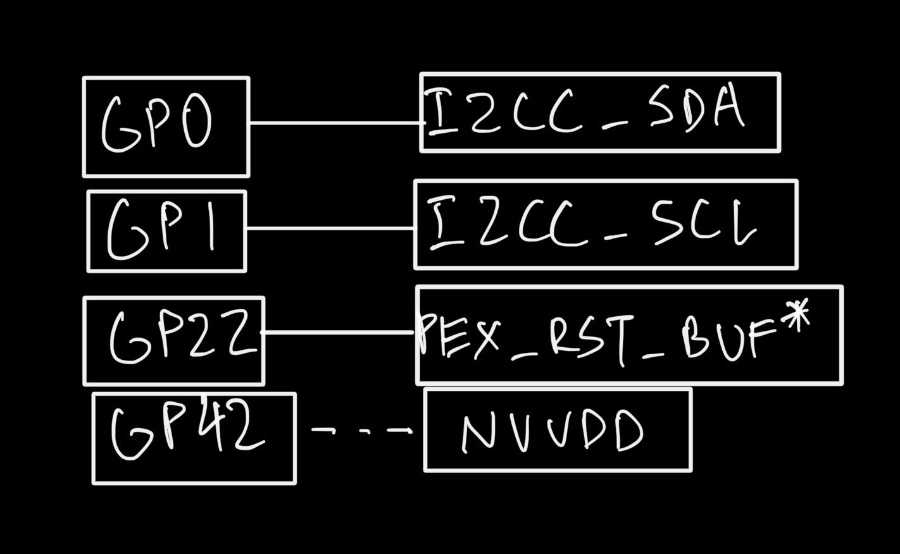
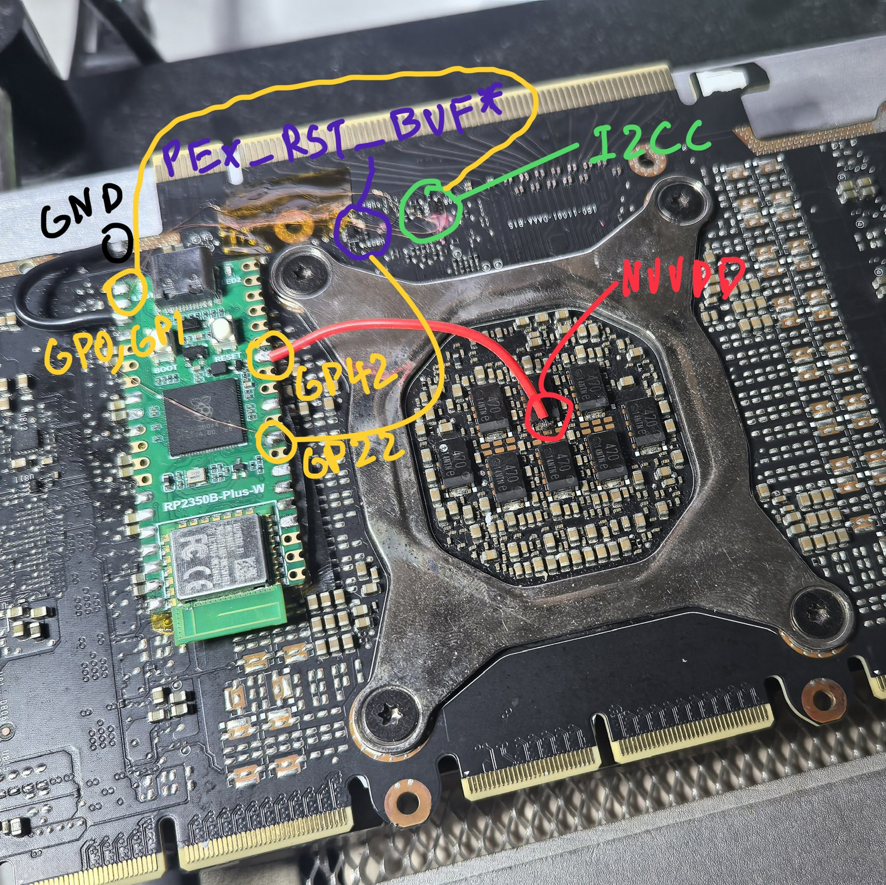
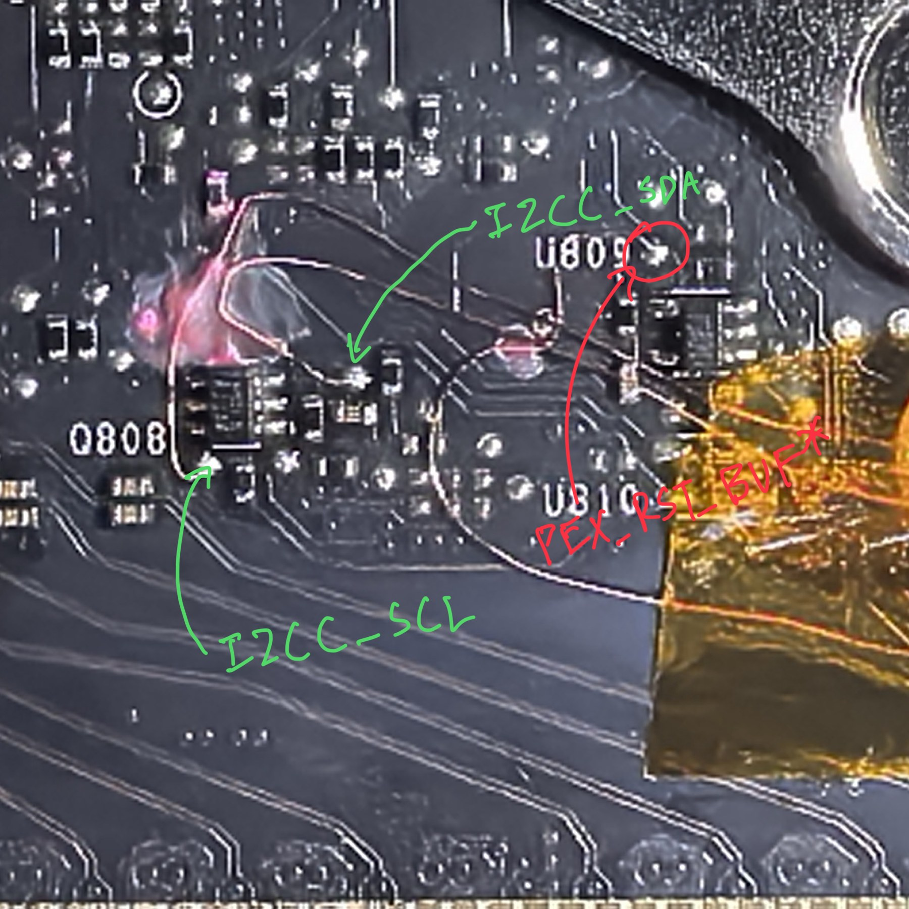
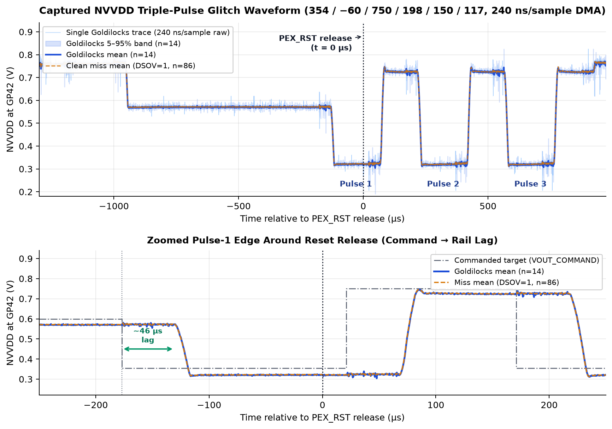
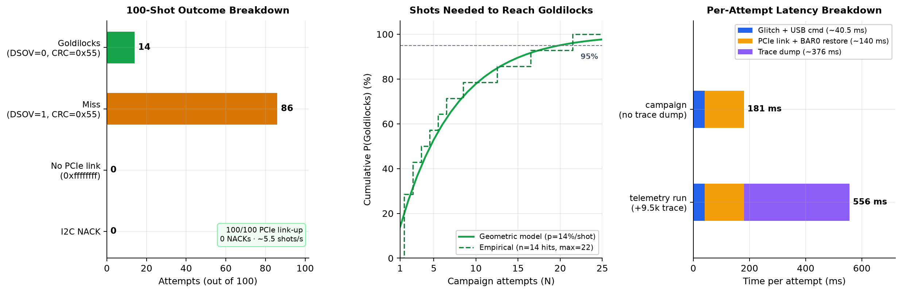

# pico-ga100vfi

Voltage-glitch toolchain for NVIDIA GA100 boards (CMP 170HX), inspired by
[`kate-land/ga100vfi`](https://github.com/kate-land/ga100vfi) on generic
RP2350A / RP2350B boards using an I2C-only actuation path.

Credits:
- [`kate-land`](https://github.com/kate-land) for discovering the GA100 VFI method,
  the fuse controller map, and the original tooling ([write-up](https://blog.kate.land/posts/using-voltage-glitching-to-unlock-the-a100/)).
- [`mellojello_`](https://github.com/JosiahWhite), who published an 8 GB CMP 170HX write-up concurrently and proved
  out the I2C + `PEX_RST` path first.

MIT licensed. See `LICENSE`.

## What it does

A GA100 samples its fuse block once, early in power-on reset. Dropping NVVDD below
the sense-amp threshold across that window makes the block read back as unburned.
The card comes up with `DSOV = 0` (software override unlocked), making the shadow
registers readable and writable.

This repo drives that dip over the board's I2C bus via PMBus commands to the
MP2888B voltage controller, timed off the `PEX_RST` release edge.

Unlocking disabled units on a GA100 goes in four steps:

1. **Glitch to Goldilocks** — run `campaign` to boot the card with software override
   unlocked (`DSOV = 0`), a valid fuse CRC, and open privilege masks.
2. **Arm fuse programming** — re-sense the control fuses so fuse-program enable comes
   back while `DSOV = 0` holds, then turn on software override and clear the write
   and burn locks in the shadow option registers.
3. **Append fuseless-fuse (FF) records** — read the die's defect masks so only good
   units get unmasked (HBM stacks, SMs, PCIe/NVLink, FP capabilities), and burn new
   FF records into blank OTP rows. The controller reads FF records in order and last
   record per block wins, so appending overrides old floorsweeping without touching
   already-burned rows.
4. **Power cycle** — power-cycle so the fuse controller replays the new FF chain on
   a clean boot.

This repo handles the voltage-glitch step (getting the card into the Goldilocks
state). For the deep dive on how the GA100 fuse controller works, read
[Kate's blog post](https://blog.kate.land/posts/using-voltage-glitching-to-unlock-the-a100/).

## How to connect Pico 2 to 170HX Board

| Connection | Required? | Purpose |
|---|---|---|
| `GND` | **yes** | common ground between Pico and GPU PCB |
| I2C SDA + SCL (`GP0` / `GP1`) | **yes** | PMBus to the MP2888B NVVDD controller |
| `PEX_RST` (`GP22`) | **yes** | fundamental reset (`PEX_RST_BUF*`); its release edge is `t = 0` |

That's it — four wires.

A direct **common ground** wire between the Pico and the GPU PCB is highly recommended.







The `PEX_RST` tap must be a **direct** wire (no series resistor) — U809 drives that
net push-pull, so a series resistor keeps the Pico from pulling it below V_IL.

### Board support

| Family | Boards | Debug ADC pin |
|---|---|---|
| RP2350B *(default, tested)* | Pico 2 W, Waveshare Plus-W | GP42 (ADC2) |
| RP2350A | Pico 2 | GP26–GP29 only |

`firmware/board.h` holds the pin map and validates family, ADC, and hardware I2C
pin choices at compile time.

### Customizing pin definitions

Edit the `#define PIN_*` macros in [`firmware/board.h`](firmware/board.h), then
rebuild and reflash:

- **`PIN_I2C_SDA` / `PIN_I2C_SCL` (I2CC):** must be **hardware I2C** pins on the
  same controller (`i2c0` or `i2c1`) — hardware I2C is required for deterministic
  1 MHz PMBus timing during the glitch. `board.h` picks `I2C_BUS` automatically from
  `PIN_I2C_SDA` and rejects mismatched pairs at compile time:

  | Controller | Valid SDA pins | Valid SCL pins |
  |---|---|---|
  | `i2c0` *(default: GP0 / GP1)* | `GP % 4 == 0` (`0, 4, 8, 12, 16, 20, 24, 28`, …) | `GP % 4 == 1` (`1, 5, 9, 13, 17, 21, 25, 29`, …) |
  | `i2c1` | `GP % 4 == 2` (`2, 6, 10, 14, 18, 22, 26`, …) | `GP % 4 == 3` (`3, 7, 11, 15, 19, 23, 27`, …) |

- **`PIN_PEX_RST`:** any unused GPIO (`0–29` on RP2350A, `0–47` on RP2350B).
- **`PIN_NVVDD_ADC`:** any ADC-capable pin for your chip (`GP26–GP29` on RP2350A,
  `GP40–GP47` on RP2350B).

*(Note: `firmware/detect.c` is a standalone probe and keeps its own `I2C_SDA = 0`,
`I2C_SCL = 1`, `i2c0` constants.)*

## Build

```sh
export PICO_SDK_PATH=/path/to-pico-sdk

# Normal build (stock clocks, no ADC — just three wires)
cmake -S firmware -B build -DPICO_BOARD=pico2_w -G Ninja
ninja -C build

# RP2350A (Pico 2)
cmake -S firmware -B build-pico2 -DPICO_BOARD=pico2 -DBOARD_RP2350A=ON -G Ninja
ninja -C build-pico2
```

Outputs `build/pwmvid.uf2` and `build/detect.uf2`. Hold BOOTSEL, plug USB, and copy
the `.uf2` onto the `RP2350` drive. More detail in [`docs/BUILD.md`](docs/BUILD.md).

### Debug build (budget oscilloscope)

The normal build is minimal: stock 150 MHz clocks, no ADC
For tuning and debugging, a **debug build** adds a 400 MHz overclock and
NVVDD rail sampling on GP42 (wire the NVVDD sense point to GP42):

```sh
cmake -S firmware -B build-debug -DPICO_BOARD=pico2_w -DDEBUG=ON -G Ninja
ninja -C build-debug
```

With `-DDEBUG=ON`:
- 400 MHz overclock (VREG 1.50 V, QMI XIP flash divider scaled)
- NVVDD ADC on GP42 at ~4.17 MSa/s (240 ns/sample)
- `y` dumps a 16384-sample rail trace
- `v` reports the live rail voltage
- `glitch done` includes an `nvvdd=` average

The ADC never feeds the glitch decision — it's purely diagnostic.

## Host usage

Plug the Pico over USB into the **same host machine that has the CMP 170HX
installed** (`/dev/ttyACM0`) — the host client needs both serial control of the
Pico and direct PCIe BAR0 access to the card. Make sure `nvidia` is
unloaded and blacklisted (otherwise the driver re-locks the VRM and binds before you
can inspect BAR0).

```sh
# Install once (or prefix commands with PYTHONPATH=host)
pip install -e host/

# Recommended: auto-calibrate v_dip and glitch to Goldilocks in one step.
# Card-to-card VRM and die variation means the optimal dip voltage differs
# between boards — adaptive finds it for your card automatically.
sudo python3 -m ga100vfi campaign --bdf 0000:1a:00.0 --adaptive

# If you already know your card's v_dip (e.g. from a previous adaptive run):
sudo python3 -m ga100vfi campaign --bdf 0000:1a:00.0 --v-dip 358

# Single-shot & diagnostic commands
sudo python3 -m ga100vfi baseline --bdf 0000:1a:00.0   # shadow fuse snapshot
sudo python3 -m ga100vfi classify --bdf 0000:1a:00.0   # restore BAR0 + run the 5 checks
sudo python3 -m ga100vfi attempt --pulses 3 --v-dip 354 --t-dip -60 --v-restore 750 --pw 198 --gap 150 --delay 117 --trace
sudo python3 -m ga100vfi revert                         # hand VRM back to PWM-VID
```

`campaign` exits `0` in the Goldilocks state with a JSON verdict on stdout and the
VRM already handed back to stock PWM-VID control.

### Adaptive calibration (`--adaptive`)

The optimal `v_dip` varies between boards due to MP2888B VRM tolerance and
die leakage — what works on one card may be too shallow or too deep on another.
With `--adaptive`, the campaign fires batches at each `v_dip`, classifies every
attempt as **under** (dsov=1, dip too shallow), **over** (dsov=0 with bad CRC
or PCIe link lost, dip too deep), or **hit** (dsov=0 with CRC=0x55, in the
Goldilocks window), then walks `v_dip` by one PMBus LSB (6.25 mV) toward the
boundary. Once a **hit** appears, it stops adjusting and grinds at that
voltage until all five Goldilocks checks pass.

The output JSON reports the calibrated `v_dip` — use it with `--v-dip` for
faster subsequent runs on the same card.

| Flag | Default | Meaning |
|---|---|---|
| `--adaptive` | off | Enable auto-calibration |
| `--v-dip` | 354 | Starting point (mV); the search adjusts from here |
| `--step` | 6 | Adjustment step (mV); 6 = one PMBus LSB (6.25 mV) |
| `--batch` | 5 | Attempts per v_dip before adjusting |
| `--min-v` | 300 | Safety floor (mV) |
| `--max-v` | 380 | Safety ceiling (mV) |

## The glitch

`t = 0` is the `PEX_RST` release edge.

| Time | Action |
|---|---|
| t = −1300 / −1200 µs | lower `VOUT_MIN` (`0x20`) and enable PMBus control (`E1 = 0xC2FA`) |
| t = −1000 µs | assert `PEX_RST`; set rail to 600 mV |
| t = `td − delay` | triple-pulse `VOUT_COMMAND` dips (`pw` µs low, `gap` µs high) |
| t = 0 µs | release `PEX_RST` (GPU samples fuses around this edge) |
| t = `post` + 10 / +60 µs | restore `VOUT_COMMAND` = `0x7E` (stock) and `VOUT_MIN` = `0x30` |
| t = `post` + 500 ms | hand back to PWM-VID mode (`E1 = 0xC2EA`), unless `revert=0` |

A single deep dip zeroes the whole fuse block (`CRC = 0x00`). Reaching Goldilocks
(`DSOV = 0`, `CRC = 0x55`, PLMs = `0xffffffff`) takes a **shallow three-pulse**
waveform that knocks out only the row 0/1 control fuses:

```
u                                        # unlock + config-id 0x1229 (stops devinit re-locking)
g 354 -60 750 -20 0 1 0 3 198 150 117 0   # shallow triple pulse (revert=0 for fast campaign)
```

**Note:** This glitch has only been tested on a single card. Silicon, VRM, and
board-to-board variation means other cards may need fine-tuning (`--v-dip`,
`--t-dip`, `--delay`, `--pw`, `--gap`; use `attempt --trace` to inspect the rail).
Full command set: [`docs/PROTOCOL.md`](docs/PROTOCOL.md).

### Measured waveform & 100-shot telemetry

Across a 100-attempt run with the settings above (`240 ns/sample` DMA trace captured
on every shot, `56.9 s` total):

- **14 Goldilocks hits** (`14.0%` per shot) · **86 clean misses** (`DSOV = 1`) ·
  **100/100 PCIe link-up** (`0` untrained-link drops, `0` I2C NACKs).
- **Throughput:** `~181 ms` per shot in `campaign` (`~5.5 shots/s`, `40.5 ms` glitch
  + `140.3 ms` PCIe link/BAR0 restore; trace dumps add `~376 ms` when enabled).
  Median time to Goldilocks is ~5 shots (`< 1 s`); 95% probability by ~20 shots
  (`~3.6 s`).
- **Command → rail lag:** measured `~46 µs` on the Pulse 1 falling edge, with
  Pulse 1 cleanly straddling `t = 0` (`~0.320 V` dip vs `~0.725 V` restore).





## Repository layout

```
firmware/
  board.h          pin map (single source of truth)
  pwmvid.c         main firmware: timed voltage stage + reset pulse
  detect.c         standalone I2C probe (plain Pico 2)
  CMakeLists.txt   builds pwmvid + detect; defaults to BOARD_RP2350B
host/
  pyproject.toml   packaging (`pip install -e host/`)
  ga100vfi/
    bar0.py        BAR0 mapping, post-reset sysfs restore, and register access
    classify.py    the five Goldilocks per-attempt checks
    glitch.py      serial client and attempt issuance
    cli.py         `ga100vfi` CLI (`campaign`, `attempt`, `classify`, `baseline`, `revert`)
docs/
  BUILD.md         prerequisites, per-family build, flashing, verification
  PROTOCOL.md      serial command set and firmware safety invariants
  images/          wiring diagram and tap-point photos
```

## Safety

- **Avoid excessive glitching.** Test boards have survived thousands of attempts, but
  repeatedly browning out NVVDD stresses the VRM and power delivery — run campaigns
  at your own risk.
- **Never drive `PEX_RST` high.** The firmware drives it low only and releases to
  high-Z; driving 3.3 V into that 1.8 V push-pull net can damage the buffer/GPU.
- **Keep NVVDD protected.** After every dip the firmware restores `VOUT_COMMAND` to
  stock and hands control back to PWM-VID (`revert=1` by default, or on `campaign`
  exit / `revert`).
- **Never power-cycle the host mid-boot.**

## Addendum: Defective vs. Disabled

Many will wonder why there are extra SMs and FBPs available to unlock — if the
card could be sold as a higher SKU for more money, why cut it down? Part of it is
price discrimination: the 170HX is artificially trimmed to target a specific market.

Still, it isn't always just segmentation. Many of the non-defective but disabled
units have worse performance characteristics, or even quirks that make them
unusable, while others work fine. The former most likely failed NVIDIA's targets for
parametric yield, while the latter were just disabled for segmentation (after all,
NVIDIA can't sell 128 SKUs of GA100 varying from 1–128 SMs!). On the flipside,
there's a slim possibility that some "defective" units end up working in your
tests — those likely missed NVIDIA's bar for functional yield, even if they happen
to pass your specific workloads.

This is all conjecture and best guesses, though. Take it with oceans of salt and
do not consider this advice.

## Disclaimer

Use at your own risk. I am not responsible for bricked cards, toasted VRMs, dead
boards, thermonuclear war, or anything else that happens from using this tool. You
are choosing to modify your own hardware.
